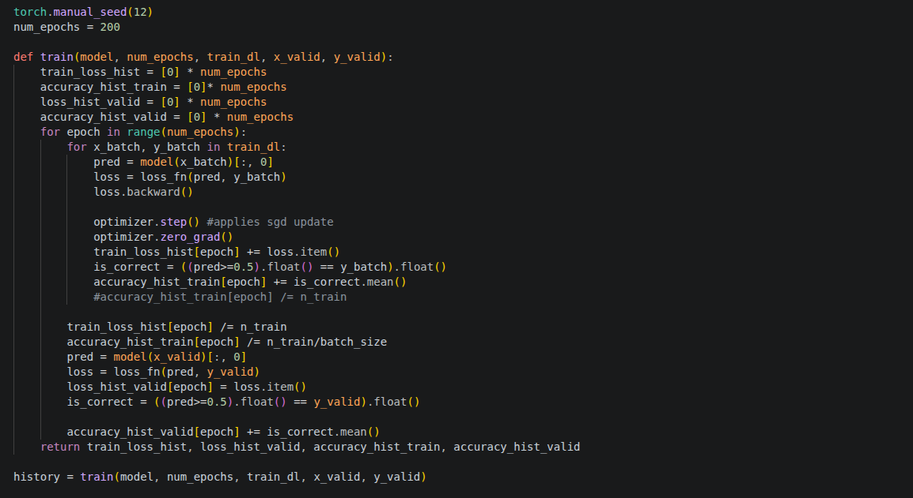
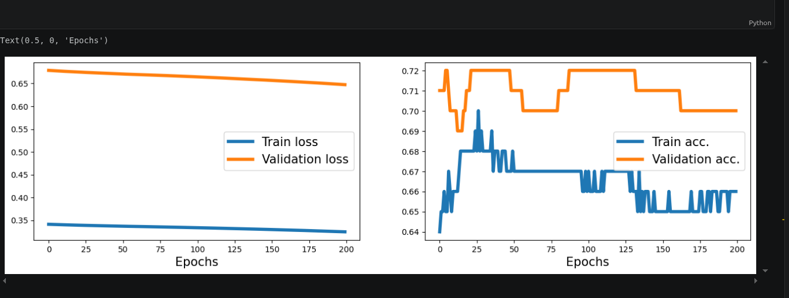
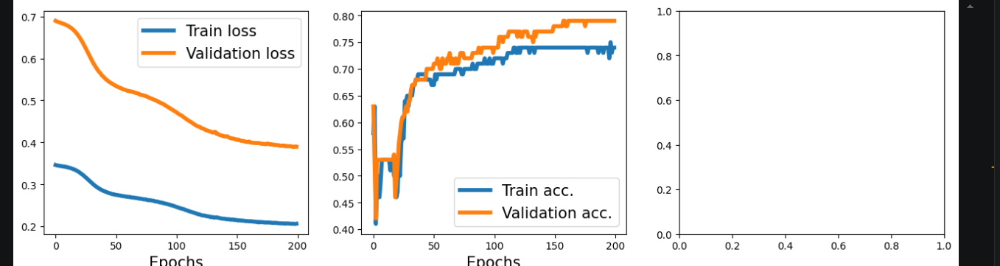
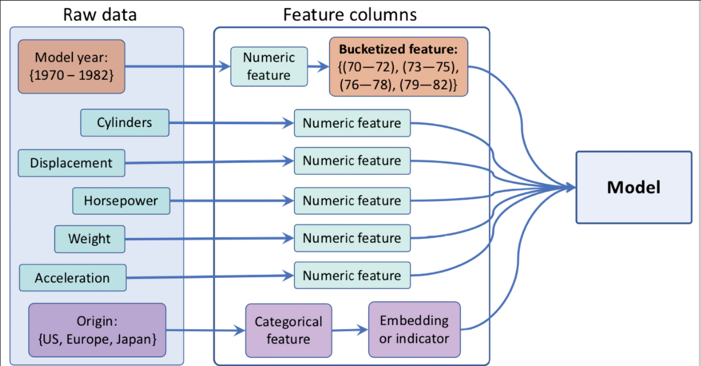
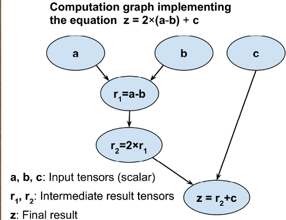

# GraphLogic

GraphLogic is a notebook-based collection of PyTorch experiments. It progresses
from scalar computational graphs and automatic differentiation to binary
classification, tabular regression, and a structured MNIST training pipeline
implemented with PyTorch Lightning.

The project is primarily educational: each notebook exposes a different part
of the model-training stack rather than presenting a single packaged
application.

## What the project demonstrates

- How PyTorch represents forward computations and calculates gradients with
  autograd.
- Why nonlinear hidden layers are required to model the XOR decision boundary.
- How to define models with `nn.Sequential` and custom `nn.Module` classes.
- How trainable parameters, Xavier/Glorot initialization, losses, optimizers,
  mini-batches, and validation metrics fit together.
- How to prepare mixed numerical and categorical tabular data for a neural
  network.
- How PyTorch Lightning separates a model from its data module and standardizes
  training, validation, and testing steps.

## Repository map

| Path | Role |
| --- | --- |
| [`computational_graph.ipynb`](./computational_graph.ipynb) | Computational graphs, gradients, `nn.Module`, and initialization |
| [`XOR_classification.ipynb`](./XOR_classification.ipynb) | Nonlinear binary classification and custom layers |
| [`predicting_fuel_inefficiency_project.ipynb`](./predicting_fuel_inefficiency_project.ipynb) | Auto MPG feature engineering and regression |
| [`pytorch_lightinig.ipynb`](./pytorch_lightinig.ipynb) | PyTorch Lightning MLP and MNIST `DataModule` |
| [`classifying_MNIST_handwritten_digits.ipynb`](./classifying_MNIST_handwritten_digits.ipynb) | Empty placeholder notebook currently present in the repository |
| [`test.py`](./test.py) | Separate OpenAI-compatible chat-completions client probe; not part of the notebook model pipeline |
| [`MNIST/raw/`](./MNIST/raw/) | Local raw MNIST files tracked with the repository |
| [`image.png`](./image.png), [`image-1.png`](./image-1.png), [`image-2.png`](./image-2.png), [`image-3.png`](./image-3.png), [`image-4.png`](./image-4.png) | Figures used in the project documentation |

## Core workflow

The notebooks follow the same general training pattern:

1. Construct or load a dataset.
2. Convert features and targets to PyTorch tensors.
3. Define a model as a sequence of layers or as a custom module.
4. Run a forward pass to obtain predictions.
5. Compute a task-specific loss.
6. Call `loss.backward()` to populate parameter gradients.
7. Update parameters with an optimizer and clear gradients.
8. Track losses and task metrics over epochs.

The lower-level notebooks show these operations explicitly. The Lightning
notebook expresses the same lifecycle through `training_step`,
`validation_step`, `test_step`, and `configure_optimizers`.

## Computational graphs and autograd

[`computational_graph.ipynb`](./computational_graph.ipynb) begins with scalar
compositions and then uses tensors with `requires_grad=True`. A representative
linear computation is:

```text
z = w x + b
L = (y - z)^2
```

Calling `L.backward()` applies the chain rule through the recorded operations
and exposes derivatives such as `w.grad` and `b.grad`. The notebook then
connects this mechanism to `torch.nn` models, binary cross-entropy, and
stochastic gradient descent.

It also demonstrates Xavier initialization through
`nn.init.xavier_normal_` and `nn.init.xavier_uniform_`. These initializers
scale starting weights according to the dimensions of the layer, helping keep
activations and gradients in a useful range at the beginning of training.

## XOR classification

[`XOR_classification.ipynb`](./XOR_classification.ipynb) creates 200 two-feature
points uniformly in `[-1, 1)` and assigns a binary label according to the sign
of the feature product:

```text
y = 1  if  x₀ x₁ >= 0
y = 0  otherwise
```

The notebook contrasts a model without hidden nonlinearities with a multilayer
perceptron:

```text
Linear(2, 4) → ReLU → Linear(4, 4) → ReLU
→ Linear(4, 1) → Sigmoid
```

The classifier uses `nn.BCELoss`, SGD, `TensorDataset`, and `DataLoader`.
Training and validation loss/accuracy histories are plotted, and
`mlxtend.plotting.plot_decision_regions` is used to visualize the learned
boundary.

The notebook also implements:

- `MyModule`, a custom `nn.Module` that assembles layers with `ModuleList`.
- `NoisyLinear`, which registers weights and biases as `nn.Parameter` objects,
  initializes them with Xavier initialization, and adds Gaussian input noise
  before the matrix multiplication:

  ```text
  x̃ = x + ε,       ε ~ Normal(0, σ)
  output = x̃W + b
  ```

These examples make parameter registration, the `forward` method, and
stochastic layer behavior explicit.





## Auto MPG regression

[`predicting_fuel_inefficiency_project.ipynb`](./predicting_fuel_inefficiency_project.ipynb)
uses the UCI Auto MPG dataset. The notebook reads the data from the URL already
embedded in the notebook:

<http://archive.ics.uci.edu/ml/machine-learning-databases/auto-mpg/auto-mpg.data>

The target is `MPG`. The input columns are `Cylinders`, `Displacement`,
`Horsepower`, `Weight`, `Acceleration`, `Model Year`, and `Origin`.
Rows containing `?` are treated as missing and removed. The data is split with
`sklearn.model_selection.train_test_split(test_size=0.2, random_state=2)`.

Feature preparation has three parts:

1. The five continuous vehicle measurements are standardized with statistics
   computed from the training set:

   ```text
   x' = (x - mean_train) / std_train
   ```

2. `Model Year` is bucketized with `torch.bucketize` using boundaries
   `[73, 76, 79]`.
3. `Origin` is converted to a one-hot tensor with
   `torch.nn.functional.one_hot`.

The resulting numerical and categorical features are concatenated before being
fed to a dynamically assembled regressor:

```text
Linear(input_size, 8) → ReLU → Linear(8, 4)
→ ReLU → Linear(4, 1)
```

Training uses batches of 8, mean squared error (`nn.MSELoss`), SGD with a
learning rate of `0.001`, and 200 epochs. The notebook logs the average
training loss periodically.




## Lightning MNIST pipeline

[`pytorch_lightinig.ipynb`](./pytorch_lightinig.ipynb) contains the repository's
MNIST implementation. `MnistDataModule` wraps
`torchvision.datasets.MNIST`, converts images with `transforms.ToTensor()`, and
creates:

- 55,000 training examples and 5,000 validation examples from the training
  split using `random_split` with a manually seeded generator.
- The standard MNIST test split.
- `DataLoader` instances with batch size 64.

`MultiLayerPerceptron` flattens each `1 × 28 × 28` image and builds hidden
layers from the configurable tuple `(32, 16)`, followed by a 10-class output
layer:

```text
Flatten → Linear(784, 32) → ReLU → Linear(32, 16)
→ ReLU → Linear(16, 10)
```

The model returns logits and uses
`torch.nn.functional.cross_entropy` for classification. Predictions are formed
with `torch.argmax(logits, dim=1)`. `torchmetrics.Accuracy` tracks training,
validation, and test accuracy, while Adam (`lr=0.001`) is returned from
`configure_optimizers`.

## Technologies and libraries

| Area | Technologies used in the repository |
| --- | --- |
| Core tensor and neural-network APIs | Python, PyTorch (`torch`, `torch.nn`, `torch.optim`) |
| Data handling | NumPy, pandas, `TensorDataset`, `DataLoader` |
| Classical ML utility | scikit-learn (`train_test_split`) |
| Visualization | Matplotlib, mlxtend decision-region plotting |
| Image classification | torchvision MNIST and transforms |
| Training framework and metrics | PyTorch Lightning, torchmetrics |
| Separate client probe | `openai` Python client in [`test.py`](./test.py) |

The repository does not include a dependency manifest; the authoritative
library usage is the import statements in the notebooks and Python source.

## References present in the project

- [UCI Auto MPG dataset](http://archive.ics.uci.edu/ml/machine-learning-databases/auto-mpg/auto-mpg.data)
- [PyTorch](https://pytorch.org/) APIs used throughout the notebooks
- [PyTorch Lightning](https://lightning.ai/docs/pytorch/stable/) APIs used in
  [`pytorch_lightinig.ipynb`](./pytorch_lightinig.ipynb)
